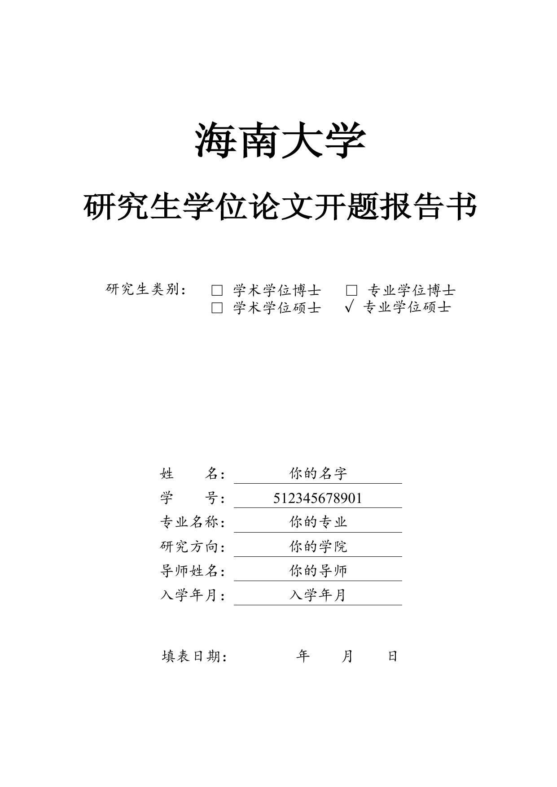

# 海南大学研究生学位论文开题报告书 · Typst 模板

<p align="center">
  
</p>

<p align="center">
  用 <a href="https://typst.app">Typst</a> 排版的海南大学研究生开题报告模板。<br>
  比 LaTeX 轻量，比 Word 可控，保存即重编译，秒出 PDF。
</p>

## 特性

- **格式还原**：封面（含「研究生类别」勾选）、首页信息表、正文、参考文献、开题报告结果页（评审意见整页表格）均按海南大学官方格式制作
- **公文式标题编号**：一级「一、」／二级「（一）」／三级「1.」／四级「1.1.」，自动编号
- **模块化写作**：正文每章一个文件，`#include` 组合，多人协作/分章撰写不打架
- **开箱即用的中文字体**：`lsj/fonts/` 内置宋体、黑体、楷体、Times New Roman，无需安装到系统
- **参考文献**：内置 `gb-7714-2015-numeric`（国标 GB/T 7714-2015 顺序编码制），BibTeX 条目即用即引

## 快速开始

前置：安装 [Typst CLI](https://github.com/typst/typst)（Arch：`sudo pacman -S typst`）。

```bash
git clone https://github.com/Rhino-Nine/HNU-Master-Thesis-Proposal-Typst-Template.git
cd HNU-Master-Thesis-Proposal-Typst-Template

# 监视模式：改任何 .typ 保存即重编译
typst watch --root . --font-path lsj/fonts lsj/main.typ
```

输出为 `lsj/main.pdf`。（`--root .` 让文档能引用上级的 `lib.typ`；`--font-path` 指定内置字体目录。）

VS Code 用户可装 [Tinymist](https://marketplace.visualstudio.com/items?itemName=myriad-dreamin.tinymist) 插件获得实时预览与语法支持。

## 目录结构

```
.
├── lib.typ                  # 模板本体：封面、正文版式、意见页（一般不用改）
├── lsj/
│   ├── main.typ             # 主入口：封面参数、章节引用、参考文献
│   ├── chapters/
│   │   ├── chapter1.typ     # 一、课题研究目的和意义
│   │   ├── chapter2.typ     # 二、课题研究内容
│   │   ├── ...              # chapter3 ~ chapter6 同理
│   │   └── chapter7.typ     # 开题报告结果页（评审意见页）
│   ├── fonts/               # 中文字体（随仓库分发，无需安装）
│   ├── figures/             # 正文插图
│   ├── ref.bib              # 参考文献条目
│   └── main.pdf             # 编译输出
```

## 使用指南

### 1. 填写封面与全局信息

编辑 `lsj/main.typ` 顶部的 `project(...)` 参数：

```typst
#show: body => project(
  cover-title:    "你的论文题目（太长可用 \n 手动换行）",
  thesis-title:   "",            // 留空则沿用封面题目
  name:           "你的名字",
  student-id:     "学号",
  major:          "工商管理硕士（MBA）",
  school:         "研究方向",
  supervisor:     "导师姓名",
  enrollment:     "2024 年 9 月",

  // 研究生类别，四选一：
  // "academic-doctor" | "professional-doctor" | "academic-master" | "professional-master"
  degree-type:    "master-professional",

  subject-source: "纵向项目",     // 正文首页信息表
  subject-nature: "应用研究",
  subject-id:     "项目编号",
  body
)
```

### 2. 按章节编写正文

每个 `chapters/chapterN.typ` 只写一章，直接以标题开头：

```typst
= 我的研究背景

正文内容……

== 小节

- 无序列表
- 有序列表用 + 开头
$ E = m c^2 $              // 行间公式
```

- 纯内容的章节**不需要** `#import`；
- 章内插图路径相对于 `chapters/` 目录：`image("../figures/xxx.png", width: 80%)`；
- 新增章节 = 新建 `chapters/chapter8.typ` + 在 `main.typ` 加一行 `#include "./chapters/chapter8.typ"`。

### 3. 参考文献

在 `lsj/ref.bib` 中维护 BibTeX 条目，正文里用 `@条目key` 引用；列表自动生成在「参考文献」一节，**只收录被引用过的条目**。

### 4. 开题报告结果页（评审意见页）

`chapters/chapter7.typ`，打印签字用可直接留空；电子版填好各参数即可：

```typst
#opinion-page(
  supervisor-comment: [该课题难度适中，工作量饱满，同意开题。],
  review-comment:     [经评审小组讨论，一致同意开题。],
  school-comment:     [同意该生通过开题。],
  group-result: "agree",   // 评审小组勾选："agree" | "revised" | "disagree" | none
  result:       "agree",   // 学院审核勾选：同上
  time:  [2026 年 11 月 15 日],
  place: [管理学院会议室],
  // 评审专家列表，每项为 (姓名, 职称, 工作单位)；留空 () 则给 5 行空白签名行
  // experts: (([张三], [教授], [海南大学]), ([李四], [副教授], [三亚学院])),
)
```

## 常见问题

**Q: 编译报 `unknown font family: kaiti`？**
字体没加载到。确认编译命令带了 `--font-path lsj/fonts`；系统里的楷体家族名可能是 `SimKai`，与 `KaiTi` 不匹配的，把 `lsj/fonts/` 里的字体文件换成标准版本。

**Q: 报错 `path would escape the project root`？**
`--root` 没加或位置不对，必须用 `typst watch --root . --font-path lsj/fonts lsj/main.typ`（在仓库根目录执行）。

**Q: 章节里调用模板函数报 `unknown variable`？**
`#include` 只搬内容不带作用域：纯内容章节无需 import，但调用 `opinion-page` 这类模板函数的章节需要在文件开头加 `#import "../../lib.typ": *`。

**Q: 页面上「参考文献」「开题报告结果」为什么没编号？**
这是刻意的——它们作为一级标题另起一页但不占章节序号（意见页表格内自印「五、开题报告结果」字样）。

## 许可证与致谢

- 模板代码基于 [MIT License](LICENSE) 开源
- 本模板修改自 [zh1-z/SJTU-Bachelor-Thesis-Proposal-Typst-Template](https://github.com/zh1-z/SJTU-Bachelor-Thesis-Proposal-Typst-Template)，原作者 **zh1-z**，感谢原作者的工作
- 校名、校徽相关标识版权归海南大学所有，仅限在校师生学术用途
